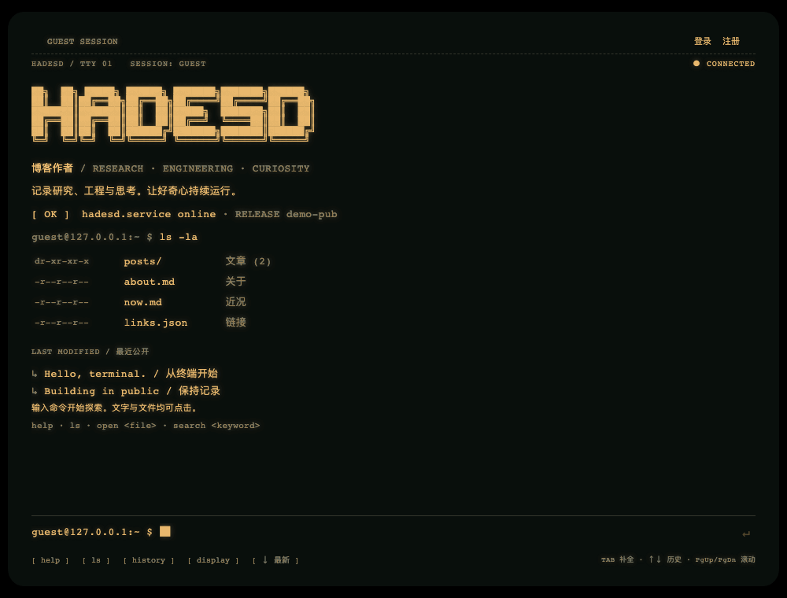
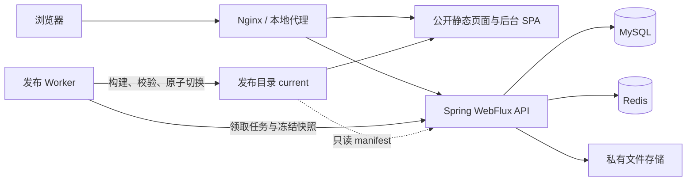

# HADESD

**a personal daemon.** 一个可以部署在自己服务器上的终端风格博客。

HADESD 是一个开源、自托管的博客与内容发布系统。每位使用者可以独立部署自己的站点，在后台配置站点名称、个人介绍、标语、开场标题和链接，并绑定自己的域名。公开站保留复古 Macintosh、CRT 和浏览器终端风格；作者在中文后台写作，读者可以注册、评论和管理个人附件。

公开阅读提供两套独立前端：终端版保留 CRT 氛围；Journal 版采用明亮留白、大标题和常规文章阅读布局，无 CRT 与开机流程。可以将它们分别部署到两个域名，共用一套内容、账号和管理后台。启用双站后，每次发布会校验两套页面并一起切换版本，见[双前端部署](docs/dual-frontends.md)。

正文从冻结快照预渲染为静态页面，账号、搜索、评论与写作操作由 Spring WebFlux 后端处理。保存草稿与公开发布相互独立，发布 Worker 构建整站并原子切换版本。



演示录制自真实界面，使用公开示例数据；为便于阅读，关闭 GPU CRT 效果。

[功能与交互](#功能与交互) · [架构](#架构) · [快速开始](#快速开始) · [源码开发](#源码开发) · [写作与发布](#写作与发布) · [部署与存储](#部署与存储) · [验证](#验证) · [维护与排查](#维护与排查) · [文档索引](#文档索引)

## 功能与交互

### 公开阅读

- **独立内容地址**：文章、项目、研究记录、关于、近况、友链、标签与搜索入口；构建生成 HTML、导航数据、RSS、sitemap 和页面元信息。
- **浏览器终端**：用目录和命令浏览内容，支持路径补全、命令历史、文本检索及 Vim 风格编辑。也可以直接点击链接阅读。
- **复古显示**：三维电脑、开机画面、滚动控制的 ASCII 旅程和 CRT 显示；支持琥珀、绿色、纸张主题，以及 CRT 强度和专注阅读设置。
- **高级 Markdown**：代码高亮与复制、表格、任务列表、脚注、数学公式、提示块、折叠内容和按需渲染的 Mermaid 图表。
- **读者互动**：注册登录、资料与密码管理、Markdown 评论和回复、个人文件上传下载。个人文件默认私有，作为公开评论附件后才允许公开读取。

终端外框固定，内部正文与命令历史支持鼠标滚轮、触摸和 PgUp / PgDn 原生滚动。长输出从开头显示，可点击「↓ 最新」回到末尾。终端是浏览器中的虚拟文件系统，不连接服务器 Shell，也不执行任意系统程序。

### 作者后台

后台位于 `/admin/`，提供内容搜索与分类、Markdown 编辑、自动保存、历史修订、媒体库、发布记录、评论管理和站点设置。

- 文稿支持回收站、恢复和受限制的永久删除；在线文稿需要先撤稿。
- 媒体支持多文件上传、拖放与粘贴插入、引用查询、筛选和批量删除，仍被保护性引用使用的文件不能直接删除。
- 发布时选择明确修订；撤稿和回滚同样经过发布任务。
- 后台有纸张手记、石墨夜间、冰川工作台和琥珀终端四套外观。

### 终端速查

```sh
help                         # 命令列表；man <command> 查看单个命令
pwd                          # 当前虚拟目录
ls -la                       # 浏览文件与目录
cd ~/posts                   # 进入文章目录；cd - 返回上次目录
open building-hadesd-architecture.md  # 导入研发手记后，在历史中阅读正文
cat building-hadesd-architecture.md   # 查看完整 Markdown 原文
vim building-hadesd-architecture.md   # 打开独立 Vim 缓冲区
search "Reactive"            # 检索当前公开索引的标题、摘要、标签与路径
login                        # 逐项输入账号信息，密码使用隐藏输入
files                        # 查看个人文件
comment                      # 对当前文章发表评论
```

| 操作 | 命令或快捷键 |
| --- | --- |
| 阅读 Markdown | `open` / `less` / `md` / `preview <file>` |
| 查找和处理原文 | `find`、`head`、`tail`、`grep`、`wc` |
| 补全与历史 | Tab / Shift+Tab 循环补全；Ctrl+Space 查看候选；单行命令框中 ↑ / ↓ 召回历史 |
| 滚动与中断 | PgUp / PgDn 滚动历史；Ctrl+C 中断命令或文字交互；Ctrl+L 清屏 |
| 账户 | `register`、`login`、`profile`、`profile edit`、`passwd`、`logout` |
| 文件与评论 | `files`、`upload`、`download <ID>`、`files rm <ID>`、`comments`、`mycomments` |
| 显示 | `display`、`theme amber\|green\|paper`、`crt off\|low\|full`、`reader on\|off` |
| 搜索面板 | Cmd+K，或在命令框外按 Ctrl+K；Esc 返回，也可在底部程序命令栏执行 `:q` |
| 重播开场 | `reboot` |

游客家目录为 `/home/guest`，登录后为 `/home/<用户名>`，`~` 指向当前家目录。支持引号、转义和公开环境变量；管道、重定向、命令串联与命令替换尚未实现。

`search` 命令在当前冻结索引中匹配；Ctrl/Cmd+K 面板的全文搜索入口会进入 `/search`，由后端检索当前公开版本。评论逐行输入 Markdown，单独输入 `.` 结束，再确认发布；每条最多 4 个附件。个人文件每账户最多 100 个、合计 100 MiB。

Vim 中按 `i` / `a` 编辑，Esc 返回 NORMAL，`:w` 保存，`:wq` 保存退出，`:q!` 放弃修改。管理员进入编辑时读取服务器最新草稿，保存生成新修订但不会自动发布；普通读者编辑的是明确标注为 `LOCAL COPY` 的浏览器本地副本。

显示层优先使用 WebGPU，回退到 WebGL2；`?gpu=webgl` 可用于检查 WebGL2。关闭 CRT、选择纸张主题或开启专注阅读时使用原生终端；系统减少动态效果设置会跳过片头。GPU 初始化失败或设备丢失时回退到原生界面。链接、输入、选择和语义仍由真实 DOM 提供，无 JavaScript 与打印场景保留静态正文。开机日志和进度条属于视觉叙事，不是后端或设备的运行诊断。

## 架构



| 模块 | 职责与主要技术 |
| --- | --- |
| `apps/web` | React 19、React Router 8、Vite、TypeScript；静态预渲染的公开站；Three.js、React Three Fiber、TSL 显示层 |
| `apps/journal` | 独立的普通博客前端；同一冻结快照与 API，独立排版、页面资源和域名元信息 |
| `apps/admin` | React + Vite 后台 SPA，TanStack Query 管理请求，Zustand 管理界面状态 |
| `backend` | Java 25、Spring Boot 4.1.1、WebFlux、R2DBC MySQL、Reactive Redis、Spring Security；Gradle Wrapper 9.7.1 |
| `apps/publisher` | Node.js Worker，领取任务、执行固定构建入口、校验产物、切换版本与清理过期发布 |
| `packages/terminal-core` | 虚拟文件系统、命令解析、执行、历史与补全 |
| `packages/markdown` | 前后台共用的 Markdown 解析、净化、排版与图表渲染 |
| `packages/contracts` / `packages/ui` | TypeScript 数据契约、共享组件与主题样式 |
| `infra` / `scripts` / `tests` | 容器与代理配置、开发运维脚本、端到端测试 |

依赖精确版本以各目录的 `package.json`、`pnpm-lock.yaml`、`backend/build.gradle` 和 `backend/gradle.lockfile` 为准。

MySQL 保存内容、不可变修订、发布任务、账户、评论、附件元数据与审计事件；Redis 保存服务端会话、限流计数及可重建缓存。文件原文存入本地目录或私有 S3 兼容存储。Flyway 在启动时执行数据库迁移，请求链使用响应式数据库与 Redis 客户端。

公开正文从磁盘直接提供，生产环境不需要 Node SSR 服务。后端只读取当前发布清单来判定公开内容，数据库中的草稿或任务状态不会提前改变公开版本。

## 快速开始

推荐使用 Linux 服务器或支持 Docker 的设备。安装 Docker Engine / Docker Desktop 和 **Docker Compose 2.24.4+**，下载本仓库后，在仓库根目录执行：

```sh
./scripts/deploy.sh init --site-origin http://localhost:18088 --admin-user admin
./scripts/deploy.sh start
./scripts/deploy.sh bootstrap
```

宿主机无需安装 Node.js、pnpm 或 Java，镜像在 Docker 中构建。首次构建需要联网下载依赖。

1. 打开 [管理后台](http://localhost:18088/admin/)，使用上面指定的用户名登录；随机初始密码保存在 `.local/docker/admin-password`，脚本不会打印密码。
2. 在「站点设置」填写名称、标语、开场标题、个人简介、首页文案与链接，并保存。
3. 到发布页面初始化空站，或新建文章后发布。等任务显示成功，再打开 [公开博客](http://localhost:18088/)。

默认配置保存在 `.env.docker`，数据目录为 `.local/docker/`，Compose 项目名为 `personal-blog`。重复初始化不会覆盖配置与密码；`bootstrap` 只用于新数据库。默认入口只监听本机；从其他设备访问或绑定域名，见[自托管部署指南](docs/self-hosting.md)。

```sh
./scripts/deploy.sh status          # 查看服务状态
./scripts/deploy.sh logs publisher  # 查看发布日志
./scripts/deploy.sh stop            # 停止服务，保留数据
```

站点设置随发布生效。部署地址由 `SITE_ORIGIN` 控制，canonical、Open Graph、RSS 和 sitemap 都使用这个地址；更换域名后需要重建容器并重新发布。HADESD 保留为软件名称与复古电脑的系统标识，公开站点名称和作者介绍可自由修改。

## 源码开发

下面适用于**本机运行应用、Docker 运行 MySQL / Redis**。它与上述 Docker 安装使用不同配置和数据目录。

### 1. 准备环境

需要：

- Node.js **24.10.0 或更高版本**。
- pnpm **11.19.0**，与根 `package.json` 的 `packageManager` 一致。
- **JDK 25**；Gradle 使用仓库内的 Wrapper，无需全局安装。
- Docker Engine / Docker Desktop 和 Docker Compose，Docker 服务已启动。

```sh
npm install --global pnpm@11.19.0
pnpm install --frozen-lockfile
pnpm run setup
```

`pnpm run setup` 生成 `.env`、`.local/` 运行目录和 `.local/admin-password`。凭据随机生成，环境文件与密码文件权限为 `600`，不会打印密码。已有 `.env` 时脚本保留配置并退出；不要先复制一个未填写的 `.env.example` 再期待初始化脚本补齐它。

管理员默认用户名为 `admin`，初始密码存于 `.local/admin-password`；也可以在创建管理员前将其改为自己的密码，至少 14 个字符。脚本同时准备 MinIO 配置，但存储模式仍为 `local`。

### 2. 启动依赖并构建

```sh
pnpm deps:up
pnpm backend:build
pnpm bootstrap
pnpm build
```

`pnpm bootstrap` 通过本地 CLI 创建初始管理员，已有管理员时拒绝覆盖。公开注册只创建普通读者账户。

### 3. 启动三个进程

分别在三个终端运行，并保持它们运行：

```sh
# 终端 1：后端 API
pnpm backend
```

```sh
# 终端 2：发布 Worker
pnpm publisher
```

```sh
# 终端 3：静态站点与同源 API 代理
pnpm serve
```

| 入口 | 默认地址 |
| --- | --- |
| 公开站 | [http://127.0.0.1:18088/](http://127.0.0.1:18088/) |
| 写作后台 | [http://127.0.0.1:18088/admin/](http://127.0.0.1:18088/admin/) |
| 后端健康检查 | [http://127.0.0.1:28080/health](http://127.0.0.1:28080/health) |
| MySQL / Redis | `127.0.0.1:23306` / `127.0.0.1:26379` |

这些端口是初始化脚本生成的本地配置，入口均绑定 loopback。

### 4. 完成首次发布

首次启动没有 `current` 发布版本，公开入口会显示等待发布。登录后台后，可在发布页面初始化空站点，或创建内容并发布。`pnpm build` 只生成构建产物，实际公开站由 Worker 发布。

仓库附带四篇介绍本博客研发过程的文章，以及「关于」「近况」页面。先查看导入计划，核对目标站点后再写入：

```sh
node --env-file=.env scripts/publish-development.mjs
node --env-file=.env scripts/publish-development.mjs --apply
```

内容源文位于 [content/development](content/development/README.md)。导入器先保存私有内容备份，再通过正常 API 创建修订和发布。只有显式指定 `--replace-demo` / `--archive-qa` 才会撤稿并归档原演示文章或已知验收草稿。旧的 `pnpm demo` 仍供隔离测试使用，不需要在正式博客运行。

### 热更新

按需启动开发服务器；同时开发多个界面时，分别在独立终端运行：

```sh
# 公开站热更新，默认 http://127.0.0.1:5173/
pnpm dev:web

# 阅读站热更新，默认 http://127.0.0.1:5175/
pnpm dev:journal

# 后台热更新，默认 http://127.0.0.1:5174/admin/
pnpm dev:admin
```

公开开发默认读取空快照。需要已发布内容时，在首次发布后指定快照的**绝对路径**：

```sh
HADESD_SNAPSHOT="$PWD/.local/published/current/snapshot.json" pnpm dev:web
```

如果修改过 `RELEASE_ROOT`，使用该目录下 `current/snapshot.json` 的实际路径。快照在启动和构建时读取；发布后需要重启开发服务器才能载入新快照。后台开发服务器连接真实后端，保存、上传和发布都会影响所连接的环境。

三个开发服务器默认代理到 `http://127.0.0.1:28080`。若更改后端端口，启动时显式传入 `API_ORIGIN`，例如：

```sh
API_ORIGIN=http://127.0.0.1:28081 pnpm dev:admin
```

### 三维效果预览

开发模式可打开 [前景对比面板](http://127.0.0.1:5173/?effects=circuit&shape=star)，在相同滚动位置比较芯片装配、信号穿屏、打印纸带和 Mac 窗口。支持：

- `effects=assembly|circuit|paper|macos`。
- `circuit` 的入口造型：`shape=star|spark|diamond|hexagon|ring`。
- 拖动进度条、切换姿态或重播开场。

预览面板和效果加载由 `import.meta.env.DEV` 控制，不会因生产 URL 带有这些参数而启用。实现说明见[前景预览文档](apps/web/app/effects/three/foreground/README.md)，场景设计背景见 [CRT 旅程](docs/crt-journey.md)。

### 常用命令

| 命令 | 用途 |
| --- | --- |
| `pnpm build` | 构建终端站、阅读站与后台，不切换公开版本 |
| `pnpm backend:build` | 清理并构建后端可执行 JAR；已有进程需另行重启 |
| `pnpm typecheck` | 执行各工作区包的类型检查 |
| `pnpm test` | 执行各工作区包的单元测试 |
| `pnpm backend:test` | 执行后端测试，集成测试需要 Docker 和 MinIO 测试镜像 |
| `pnpm test:e2e` | 对运行中的隔离环境执行 Playwright 测试 |
| `node scripts/openapi.mjs` | 重新生成 `docs/openapi.json` |
| `pnpm backup` / `pnpm restore:drill` | 本地开发数据备份与隔离恢复演练 |
| `pnpm media:cleanup` | 预览孤立媒体清理候选；加 `--apply` 才执行删除 |

## 写作与发布

1. **创建内容**：支持文章 `POST`、项目 `PROJECT`、研究记录 `RESEARCH` 和页面 `PAGE`；页面的固定标识为 `about` / `now`。
2. **编辑草稿**：填写标题、摘要、标签、语言和 Markdown。编辑器在停顿后自动保存，也可手动保存；每次保存产生不可变修订。版本冲突时暂停保存并保留本地文字。
3. **插入附件**：通过媒体库、拖放或粘贴插入。文件特征由服务端检查，图片上限 10 MiB，PDF / ZIP 上限 25 MiB，UTF-8 文本上限 2 MiB；HTML / SVG 不受支持。未被当前公开版本引用的作者附件保持私有。
4. **选择修订并发布**：Worker 从冻结快照构建，任务依次经历 `QUEUED → BUILDING → READY → DEPLOYING → SUCCEEDED`。构建或校验在切换前失败时，旧站继续提供服务。
5. **更新与撤稿**：修改已上线内容只改变草稿；再次发布后才更新正文。撤稿生成不含该内容的新版本，原地址返回 404，公开搜索与附件访问随当前版本更新。
6. **回滚与设置**：回滚保留版本会生成新发布，不改写历史修订；目标版本包含回收站文稿时需先恢复文稿。站点设置保存后不会立即生效，会随下一次普通发布或撤稿上线，也可单独发布设置；回滚恢复目标快照中的设置。当前版本与前 5 个成功历史版本用于保留和回滚，过期版本不可回滚。

默认发布目录结构如下：

```text
.local/published/
├── current -> releases/<releaseId>
├── releases/<releaseId>/
│   ├── manifest.json       # 当前公开版本的权威清单
│   ├── snapshot.json       # 私有冻结快照，不作为公开静态文件提供
│   ├── site/               # 终端站 HTML、导航数据、RSS、sitemap
│   └── journal/            # 启用 JOURNAL_SITE_ORIGIN 时的阅读站产物
├── assets/                 # 保留带内容哈希的代码资源，支持旧标签页
├── journal-assets/         # 阅读站独立的哈希资源
├── staging/                # 尚未激活的版本
└── work/                   # 每次发布的构建工作目录
```

Worker 完成构建与校验后原子切换 `current`，后端读取 manifest 判断可见版本。任务带租约、心跳与回报校验；Worker 切换后意外退出时，可通过 manifest 对账。持有旧 `releaseId` 的请求会收到 `409 RELEASE_CHANGED`，客户端应刷新当前版本。

管理员和读者使用 Redis 服务端 Session，Cookie 设置 HttpOnly、SameSite=Strict 和 `/api` 路径；写入保留 CSRF 校验。Worker 使用独立令牌，公开代理拒绝 `/api/v1/internal`。Markdown 不执行原始 HTML 或 MDX，数学和图表经过受限渲染。更多边界见 [API 契约](docs/api-contract.md)、[博客交互](docs/blog.md)和[媒体访问](docs/media-delivery.md)。

## 部署与存储

### 部署方式

| 方式 | 配置与用途 |
| --- | --- |
| 独立 Docker 安装 | `deploy.sh` + `.env.docker` + `compose.standalone.yaml`；供新使用者部署自己的博客 |
| 本地源码开发 | `.env` + `dependencies.yaml`；Docker 只运行 MySQL / Redis，应用在宿主机运行 |
| 自定义基础设施 | `compose.yaml` 配合存储等覆盖文件；按自己的环境管理目录、权限、网络和备份 |
| 原有专用生产环境 | `compose.production.yaml` + `infra/deploy/`；保留既有 WireGuard 运维方案 |

完整 Compose 运行 MySQL、Redis、后端、Worker 和 Nginx。默认只有 Nginx 暴露 HTTP 入口；后端只读挂载发布目录，Worker 负责写入。独立安装使用初始化时的 UID/GID 访问数据目录，不需要将目录改为全局可写。

不同部署必须使用不同的环境文件、Compose 项目名、数据目录和监听端口。仅更换项目名不会隔离共用的宿主机目录。HTTPS、NAS、多个实例、升级与备份见[自托管部署指南](docs/self-hosting.md)。

### 关键配置

| 配置 | 说明 |
| --- | --- |
| `DB_*` / `REDIS_*` | 数据库和 Redis 地址、账号与密码；完整 Compose 在容器内覆盖服务地址 |
| `SERVER_PORT` / `API_ORIGIN` / `LOCAL_PORT` | 本机后端端口、代理及 Worker 的后端地址、同源入口端口 |
| `RELEASE_ROOT` / `MEDIA_ROOT` | 宿主机发布与本地媒体持久目录的绝对路径 |
| `ADMIN_BOOTSTRAP_*` | 初始管理员用户名与密码文件，只用于初始化 |
| `WORKER_TOKEN` | 后端与 Worker 共享的私有令牌 |
| `SITE_ORIGIN` | canonical、RSS、sitemap 使用的正式站点地址；默认 `http://localhost:18088`，只能包含协议、主机与可选端口，不支持子目录部署 |
| `SESSION_SECURE` | 本地 HTTP 使用 `false`，HTTPS 部署使用 `true` |
| `STORAGE_MODE` | `local` 或 `s3`；仅修改此值不会迁移已有文件 |
| `S3_*` / `AWS_*` | 私有桶、区域、兼容端点与凭据；AWS SDK 支持默认凭据链 |

变量模板见 [.env.example](.env.example)，默认值和容器覆盖规则见[配置说明](docs/configuration.md)。

### 文件存储

| 方案 | 配置与入口 |
| --- | --- |
| 本地目录 | 默认 `STORAGE_MODE=local`，原文件保存在 `MEDIA_ROOT` |
| 私有 MinIO | 在基础 Compose 上叠加 `compose.minio.yaml`，容器使用私有 S3 端点；需要主机访问时再叠加 `compose.minio.local.yaml` |
| 外部 S3 兼容服务 | 设置 `S3_BUCKET`、`S3_REGION` 和凭据，按服务设置 `S3_ENDPOINT` / `S3_PATH_STYLE`；叠加 `compose.s3.yaml` 为后端提供出网网络 |

外部 S3 示例仅适用于新安装或已经完成附件迁移校验的环境。先替换 setup 生成的 MinIO 桶、端点与凭据；使用 AWS 默认端点时清空 `S3_ENDPOINT`，并将 `S3_PATH_STYLE` 改为 `false`。下面的覆盖文件会直接将后端切换到 S3：

```sh
docker compose --env-file .env \
  -f infra/compose/compose.yaml \
  -f infra/compose/compose.s3.yaml up -d --wait
```

已有安装可执行 `node scripts/setup-minio.mjs` 补充缺失配置；它保留非空设置及当前存储模式。迁移需要暂停所有写入、备份、预检、复制并校验完成后再切换存储，步骤见 [MinIO 与存储迁移](docs/minio.md)。

存储桶保持私有，浏览器通过后端附件接口访问。作者附件按当前发布引用校验，读者附件按公开评论引用校验；默认不允许共享缓存绕过这些检查。浏览器不获得存储凭据或直连私有桶的下载地址。

### HTTPS 与已有生产环境

新安装使用 `compose.standalone.yaml`，将宿主机 TLS 入口反向代理到本地 HTTP 端口。该覆盖配置根据 `SITE_ORIGIN` 设置受信任的源站协议与主机，具体操作见[绑定域名](docs/self-hosting.md#绑定域名与-https)。

`compose.production.yaml`、`infra/nginx/` 和 `infra/deploy/` 包含现有部署的 WireGuard、TLS 入口、systemd 和备份方案。其中生产包装器绑定既定路径并组合 MinIO 配置，应按实际主机、网络和存储调整后使用。

生产覆盖文件使用 `!override`，需要 Docker Compose 2.24.4 或更高版本，并要求配置 `WIREGUARD_BIND_IP` 与 `NGINX_CONFIG_FILE`。

对外部署时设置自己的 `SITE_ORIGIN`、安全 Cookie、TLS 及可信代理配置，保持内部 API 不可从公开入口访问。HTML、导航数据和受权限约束的媒体不应被 CDN 长期缓存；如另加缓存，发布、撤稿及权限变化需要配套失效机制。

具体拓扑、运维路径和历史部署记录见[部署说明](docs/deployment.md)与[生产运维说明](infra/deploy/README.md)。

## 验证

类型检查与工作区单元测试：

```sh
pnpm typecheck
pnpm test
# 根 scripts/ 的测试不包含在 pnpm test 中
node --test scripts/*.test.mjs
```

后端测试使用 Testcontainers。确保 Docker 正常运行，并先构建默认的 MinIO 测试镜像：

```sh
docker compose --env-file .env \
  -f infra/compose/compose.yaml \
  -f infra/compose/compose.minio.yaml build minio
pnpm backend:test
```

也可用 `MINIO_TEST_IMAGE` 指定兼容的测试镜像。JUnit 报告生成在 `backend/build/reports/tests/test/index.html`。

端到端测试需要**独立数据库、附件存储和发布目录**，并已完成管理员初始化、前端构建和示例发布；后端、Worker 和 `pnpm serve` 必须保持运行，Playwright 不会自动启动它们。

```sh
pnpm exec playwright install chromium
# 仅在上述隔离环境中运行；该变量本身不会创建或隔离数据
HADESD_ISOLATED_TEST=true pnpm test:e2e
```

测试会实际创建账户、文稿、附件与评论，并执行发布、修订、撤稿和回滚。部分测试会恢复公开版本，但验收草稿、修订或审计记录可能保留；不要指向正式数据。未设置隔离标识也不代表所有测试都是只读。

浏览器报告位于 `.local/reports/playwright/index.html`，失败轨迹和截图位于 `.local/reports/test-results/`。历史验收数据见 `docs/` 内对应记录，不代表任意新工作区已经通过验证。

## 维护与排查

### 备份与恢复

对使用 `pnpm deps:up` 的本地开发环境，暂停写作、上传、评论变更、删除和发布等写入后运行：

```sh
pnpm backup
pnpm restore:drill
```

备份保存至 `.local/backups/<timestamp>/`，包含 MySQL 转储、媒体、保留的发布目录、私有环境配置及文件校验信息。S3 模式会按数据库引用导出当前对象，需要已构建的后端 JAR、JDK 25 和可达的数据库 / S3 地址；它不备份 MinIO 的全部对象历史或服务配置。

恢复演练将 SQL 导入独立临时数据库，并在独立目录校验媒体、发布文件、符号链接和当前 manifest，不覆盖运行中的数据。结果写入 `.local/reports/restore.json`。

这两个脚本固定使用本地依赖 Compose，不能直接作为全栈 Compose 或生产数据库的备份工具。独立 Docker 安装见[备份与恢复](docs/self-hosting.md#备份与恢复)。已有生产环境使用 `infra/deploy/backup-origin.sh`，完整备份与空数据库恢复步骤见[生产备份说明](infra/deploy/README.md)。Redis 会话可失效后重新登录，正文恢复依赖 MySQL、媒体与发布目录的一致备份。

### 媒体清理与故障演练

```sh
pnpm media:cleanup          # 仅预览
pnpm media:cleanup --apply  # 删除满足条件的孤立媒体
```

该清理命令面向超过 7 天、没有修订或保留版本引用的作者附件。后台媒体库另提供带引用保护的交互式删除；具体规则见[后台资料管理](docs/admin-management.md)。

`pnpm test:fault` 需要已发布的 demo 示例，会临时停止本地依赖 Compose 的 MySQL / Redis，检查静态阅读与动态功能的降级，并在结束时恢复依赖。仅在本地维护窗口执行，不与写作、发布或 E2E 同时运行；报告为 `.local/reports/fault-check.json`。

### 常见问题

| 现象 | 检查方向 |
| --- | --- |
| 首页显示等待发布 | 到后台初始化空站或发布内容；确认 Worker 正在运行。单独执行 `pnpm build` 不会生成 `current` 指针 |
| 后端无法启动 | 检查 JDK 25、数据库 / Redis 健康状态及 `.env`；先执行 `pnpm backend:build` |
| 修改代码后后端行为未更新 | 重新构建后重启后端；运行脚本使用内容哈希命名的 JAR 副本 |
| 后台或开发代理无法访问 API | 检查端口占用，保持 `SERVER_PORT` 与 `API_ORIGIN` 一致；开发服务器显式传入代理地址 |
| `401` / `403` | 检查登录状态、权限、CSRF；本地 HTTP 不应启用安全 Cookie。公开附件也可能因来源检查被拒绝 |
| `409` | 草稿版本冲突需重新核对修订；`RELEASE_CHANGED` 需刷新公开版本 |
| `429` | 请求触发限流，等待限流窗口后重试 |
| 发布停留在队列或构建失败 | 检查 Worker、共享令牌、目录权限与构建日志；切换前失败保留旧版本 |
| 切换存储后附件缺失 | 核对迁移结果、桶、端点和运行进程的存储配置，不能只修改 `STORAGE_MODE` |

## 文档索引

| 主题 | 文档 |
| --- | --- |
| 账号、评论、文件与终端 | [博客交互](docs/blog.md) · [HadesShell](packages/terminal-core/README.md) |
| 写作与后台管理 | [Markdown 指南](docs/markdown-guide.md) · [后台资料管理](docs/admin-management.md) · [后台实现](docs/admin-notes.md) |
| 研发文章与双站 | [研发内容包](content/development/README.md) · [双前端部署](docs/dual-frontends.md) |
| 配置与部署 | [自托管部署](docs/self-hosting.md) · [环境变量](docs/configuration.md) · [部署](docs/deployment.md) · [生产备份与恢复](infra/deploy/README.md) |
| 存储与访问 | [MinIO 与迁移](docs/minio.md) · [媒体访问与缓存](docs/media-delivery.md) |
| API 与后端 | [接口契约](docs/api-contract.md) · [OpenAPI 3.1](docs/openapi.json) · [后端实现](docs/backend-notes.md) |
| 视觉与性能 | [CRT 旅程](docs/crt-journey.md) · [前景预览](apps/web/app/effects/three/foreground/README.md) · [性能记录](docs/performance.md) |
| 设计与历史证据 | [设计决策](docs/decisions.md) · [实施进度](docs/progress.md) · [终端滚动验收](docs/terminal-scroll-validation.md) · [部署验收](docs/deployment-validation.md) |

部分设计文档和验收记录描述的是特定历史版本，阅读时请结合日期与当前源码。

### 重新录制 README 动图

安装工作区依赖、Playwright Chromium 和带 Pillow 的 Python 3 后执行：

```sh
pnpm exec playwright install chromium
node scripts/record-terminal-demo.mjs
```

脚本在独立本地端口启动实际界面，读取 `scripts/fixtures/terminal-demo.snapshot.json` 并提供只读演示响应，无需后端或真实账户。输出覆盖 `docs/assets/terminal-demo.gif`；可用 `DEMO_PORT` 更换端口，`PYTHON` 指定 Python，`DEMO_KEEP_FRAMES=1` 保留临时截图。

## 许可与来源

本仓库使用 [MIT License](LICENSE)。

ASCII 滚筒的圆柱变形与逐格滚动适配自 [Skyworks 的 CylinderPlane](https://github.com/shader-sweden/skyworks/blob/2eb7ad3b4b861cbfc17adebff5e9fa8c861babeb/src/components/scenes/hero/cylinder-plane.tsx)，相关来源也保留在实现注释和 [CRT 旅程说明](docs/crt-journey.md)中。

### 阅读站文案与内容来源

阅读站身份与首页说明在 `apps/journal/app/site.ts`；文章和固定页仍由共享内容系统提供。首页按真实文章生成列表，不需要为版式补齐专题或封面。四篇研发文章从实际问题解释实现，附有架构、渲染、发布与备份示意图；关于与近况源文只使用可核实的站点信息。来源区分、配图维护和替换注意事项见[内容编辑说明](docs/editorial-content.md)。
