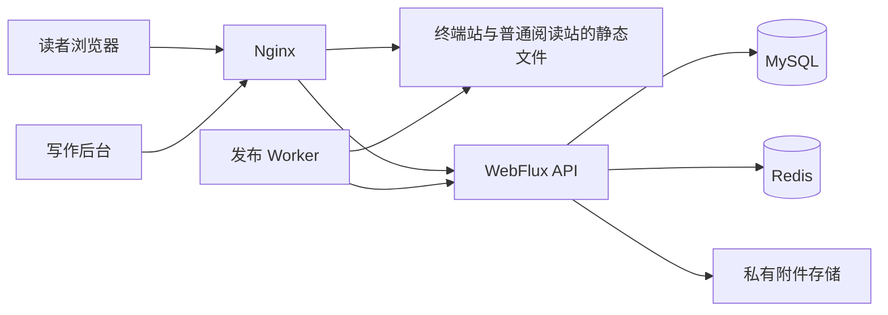

一个博客最常见的操作是阅读，但最容易出错的地方往往是修改：自动保存有没有把未写完的段落公开？更新附件后旧文章还能不能打开？发布构建失败时，读者会看到什么？

HADESD 把这些问题放在界面之前处理。终端和 CRT 是阅读方式，底下仍然是一套有草稿、修订、账号和发布边界的内容系统。理解它的架构，可以先沿着一篇文章从编辑到阅读的路径走一遍。

## 三条路径，而不是一个处理所有请求的页面服务

当前工程分成两个公开阅读前端、管理端、后端 API 和发布 Worker。它们在同一仓库中维护，但承担不同工作。

| 模块 | 主要职责 | 不负责什么 |
| --- | --- | --- |
| `apps/web` | 公开页面、阅读终端、浏览器中的 CRT 显示 | 管理草稿和数据库事务 |
| `apps/journal` | 常规博客布局、文章列表与直接阅读 | 维护另一份内容库或发布历史 |
| `apps/admin` | 编辑、媒体管理、发布与站点设置 | 直接写数据库或切换线上文件 |
| `backend` | 账号、修订、评论、搜索、附件授权、发布任务 | 执行前端构建和写入发布目录 |
| `apps/publisher` | 获取冻结快照、构建、校验、切换静态版本 | 自行决定哪些草稿可以公开 |

从读者的角度，Nginx 按域名提供对应的阅读界面，再把请求分成两类：页面和静态资源从文件系统读取，`/api/` 请求代理到同一后端。管理端也是独立构建的前端应用，通过同源 API 完成操作。



图中的 Worker 和后端之间通过内部 API 协作。浏览器不能通过公开代理调用这些内部发布接口。

## 两种阅读方式，只保留一份内容事实

终端站把导航变成虚拟目录和命令，普通阅读站使用文章列表、导航栏与正文页面。第二种界面不应要求作者再维护一套文章：两个前端读取同一份冻结快照，使用相同的内容 ID、修订 ID 和路由。

部署时，`SITE_ORIGIN` 指向终端站，设置可选的 `JOURNAL_SITE_ORIGIN` 后启用普通阅读站。两个域名各自生成 canonical、分享地址和订阅文件，静态代码资源也使用不同目录；它们不通过复制数据库来保持一致。

这种“同内容、不同呈现”的范围也延伸到账号和评论。两个站点连接同一后端，所以账户和内容讨论共享；但浏览器 Cookie 仍属于各自域名，用户需要分别登录。这里没有实现跨域单点登录，也没有把会话令牌放入跳转链接。

## React Router 用在构建时，也用在浏览器里

两个公开前端都使用 React 和 React Router Framework。各自的 `react-router.config.ts` 明确设置了 `ssr: false`，同时提供需要预渲染的路径列表：固定栏目、快照中的文章地址，以及文章标签。

这意味着生产阅读入口不需要常驻的 Node 页面渲染服务。发布 Worker 在构建阶段运行 Node，把指定快照变成 HTML 和导航所需的静态数据；上线后由 Nginx 交付这些产物。浏览器加载 JavaScript 后，再接管终端交互和页面导航。

因此，源码中的 `loader` 并不等于“每次访问都去后端读取数据库”。公开页面的 loader 从构建输入读取冻结快照；搜索、登录、评论等实时能力才在浏览器里调用后端 API。

这层分工有两个实际结果：

1. 已生成的正文可以独立于动态 API 提供阅读，前提是静态入口和发布目录仍然可用。
2. 修改前端代码或后台设置不会立即改变已发布页面，必须产生新发布版本。

第二点既是保护，也是操作成本。系统不会把“源码构建成功”和“公开站已经更新”混为一谈。

## 草稿是可继续编辑的，修订是不可变的

数据模型中，`content` 表达一篇内容的身份，`revision` 表达某次保存的具体文字和元数据。标题、slug、摘要、正文、标签、语言和封面引用随修订一起保存。

例如，一篇文章可以有这样的状态：

```text
内容 A
├─ 修订 1：已经公开
├─ 修订 2：补充代码，尚未公开
└─ 修订 3：修改结论，当前最新草稿
```

读者仍然看到修订 1。后台“保存”只推进草稿，发布操作才指定某个 `revisionId` 进入下一份公开快照。一次普通发布只替换目标内容的指定修订，其他已公开内容继续保留原有修订。

为了防止两个编辑窗口静默覆盖，保存还带有内容版本号。服务端使用带版本条件的更新；版本不匹配时返回 `409 REVISION_CONFLICT`，让冲突显式出现。界面应该保留本地编辑文本，而不是把最后到达服务器的请求当作正确答案。

## WebFlux 的意义在于整条请求链

后端使用 Java、Spring Boot 和 WebFlux。数据库访问使用 R2DBC 的 `DatabaseClient`，Redis 使用响应式客户端，事务使用 `TransactionalOperator`。

这项选择的重点不是把返回值写成 `Mono` 就算完成。密码散列、文件检查或同步文件操作如果直接占住请求线程，外层的响应式接口也无法消除阻塞。当前实现将 BCrypt、部分媒体检查和本地文件操作放到 `boundedElastic`，S3 则使用异步客户端。

JDBC 仍然存在，但用于启动时的 Flyway 迁移和显式维护 CLI，不承担正常 HTTP 请求中的内容查询。这是明确的线程边界，而不是为了统一技术名词而消灭所有同步代码。

响应式链路也有成本：错误恢复、事务作用域和资源释放更难从顺序代码直觉判断。因此，这个项目的后端测试不仅检查成功响应，还覆盖会话故障、并发版本冲突和发布租约失效等场景。

## 为什么没有再加一套搜索服务

当前全文检索使用 MySQL 的 ngram 全文索引，搜索投影保存在 `release_entry` 中，并且带有 `release_id`。查询面向当前公开版本，不会把最新草稿混入结果。

单字和包含标点的输入需要单独处理。例如 `C++` 或一个汉字不能简单假定会得到理想的全文分词结果。实现为这类查询使用标题、标签的字面量匹配，并对 `LIKE` 特殊字符转义。

这不是声称 MySQL 适合所有搜索需求，而是承认当前规模与功能边界：博客需要一个与发布版本一致、能维护和备份的搜索入口。引入独立搜索集群还意味着多一份同步状态和故障恢复流程，现阶段没有必要先承担这笔成本。

## 附件与登录也要守住同一个公开边界

上传成功不代表附件已经公开。原文件默认保存在私有目录或私有桶中；公开附件接口还要检查当前发布是否引用它。读者文件则有独立的归属和评论引用规则。

账号使用 Redis 服务端 Session，浏览器写操作保留 CSRF 校验。公开注册建立普通读者账户，初始管理员由受控 CLI 创建。后台按钮和终端命令共用后端权限规则，命令行外观不会获得额外权限。

Markdown 同样不是可执行应用代码。渲染器跳过原始 HTML，使用净化流程，Mermaid 也经过单独的策略检查。作者是在提交内容，不是在向服务器上传一段构建脚本。

## 这种架构适合什么

HADESD 当前是一套部署对应一份博客内容，可以有两种阅读呈现。它适合希望保留静态阅读、拥有完整写作后台，又愿意维护数据库和发布器的使用者。

它的代价同样明确：发布需要等待整站构建；数据库、媒体和发布目录需要一致备份；前端与后端的共享契约需要同步演进。一个只有几篇文章、完全不需要账号和在线写作的网站，用更简单的静态生成器也很合理。

这里最有复用价值的不是某个框架版本，而是把“正在编辑什么”“准备发布什么”和“读者此刻能看到什么”拆成三个可以检查的状态。

## 对照源码阅读

- `apps/web/react-router.config.ts`：预渲染路径与运行方式。
- `apps/journal/react-router.config.ts`：普通阅读站使用同一快照生成路由。
- `apps/web/app/snapshot.server.ts`：构建输入与公开索引。
- `scripts/nginx-config.mjs`：按域名选择静态目录与同源 API。
- `backend/src/main/java/sh/hades/daemon/content/ContentService.java`：不可变修订与版本冲突。
- `backend/src/main/java/sh/hades/daemon/search/MySqlSearch.java`：当前发布的检索边界。
- `backend/src/main/java/sh/hades/daemon/auth/SecurityConfig.java`：浏览器会话与内部接口安全链。
- `packages/markdown/src/index.tsx`：Markdown 渲染与净化入口。
