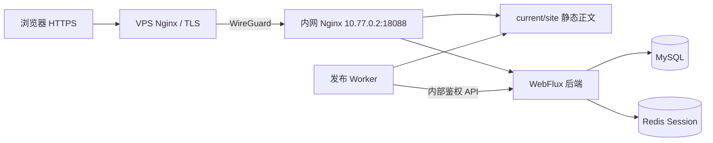

# 生产部署与运维

生产入口为 [https://hadesd.sh](https://hadesd.sh)，后台为 [https://hadesd.sh/admin/](https://hadesd.sh/admin/)。2026-09-10 已完成真实服务器构建发布、注册登录、文件、评论权限及 CRT 终端验收，最后一次停写备份已保存。具体结果和测试边界见 [progress.md](progress.md)。本文描述源站、网络和日常操作；历史 Docker Desktop 验收仍单独保留在 [deployment-validation.md](deployment-validation.md)，不将本地验收等同于生产验收。

## 请求与数据路径



VPS 终止 TLS，沿 WireGuard 转发到内网源站。源站端口只绑定 WireGuard 地址，MySQL、Redis、backend 和 publisher 不映射公网端口。公开静态正文由 Nginx 直接读取；浏览器终端不连接服务器 Shell，生产不运行 Vite 开发服务器或请求时 Node SSR。

代理配置来源为 [public-edge.conf](../infra/nginx/public-edge.conf) 与 [wireguard-origin.conf](../infra/nginx/wireguard-origin.conf)。VPS 重写 Host、协议与客户端地址，清除外部提供的 `Forwarded` 等头；源站只信任指定 WireGuard 对端。后端仅在生产覆盖配置中启用转发头处理，保持 Secure Session Cookie。`/api/v1/internal` 在两层代理均被拒绝，`snapshot.json`、`manifest.json`、`releases/`、`work/`、`staging/` 不作为公开 URL。

Cloudflare 地址信任规则来自仓库中的 [cloudflare-realip.conf](../infra/nginx/cloudflare-realip.conf)，只接受受信任对端给出的访客地址；它本身不代表启用了 HTML 或媒体缓存。更改 DNS / CDN 行为时，需要重新验证撤稿、登录、CSRF 和真实客户端限流。

## 源站位置与启动

| 项目 | 生产位置 / 行为 |
| --- | --- |
| 应用源码 | `/opt/hadesd/app` |
| Compose 包装器 | `/usr/local/sbin/hadesd-compose` |
| 配置组合 | `infra/compose/compose.yaml` + `compose.production.yaml` |
| 私有环境 | `/etc/hadesd/app.env`，root 所有、`0600` |
| 管理员密码文件 | `/etc/hadesd/admin-password`，UID 1000 所有、`0400` |
| 媒体 | `/srv/hadesd/media`，backend 所需目录可由 UID 1000 读写 |
| 发布内容 | `/srv/hadesd/published`，publisher 可写，backend / Nginx 只读 |
| 当前版本 | `published/current -> releases/<releaseId>` |
| 手动备份 | `/srv/hadesd/backups/<UTC时间戳>`，root 所有、`0700` |

[生产 Compose 覆盖文件](../infra/compose/compose.production.yaml) 使用 `!override` 替换开发端口，需要 Docker Compose 2.24.4 或更新版本。`NGINX_CONFIG_FILE` 指向主机上的生产源站配置绝对路径；缺失时拒绝创建空目录来代替文件。凭据通过主机私有文件与容器环境传入，不放入 Git 或命令参数。

[服务单元](../infra/deploy/hadesd.service) 安装为 `hadesd.service`，依赖 Docker 与 `wg-quick@wg-hades.service`。它通过包装器执行 Compose，启动时等待健康检查，停止时保留容器数据卷。单元是 oneshot，`active (exited)` 只说明启动命令完成，容器是否健康仍看 Compose：

```sh
sudo systemctl status hadesd.service --no-pager
sudo /usr/local/sbin/hadesd-compose ps
sudo /usr/local/sbin/hadesd-compose logs --tail=80 backend publisher nginx
```

已有生产环境通过上述包装器管理，避免误用仓库本地 `.env` 或开发 Compose 项目。升级源码与镜像前先安排手动备份。启动命令使用本地已构建镜像；构建、拉取和应用升级与服务自启是不同操作。

包装器源码为 [infra/deploy/hadesd-compose](../infra/deploy/hadesd-compose)，安装到 `/usr/local/sbin/hadesd-compose`。生产发布容器默认限制为 6 GiB，构建子进程的 Node 堆为 4096 MiB，为 Rolldown 等原生分配保留空间；可在私有环境文件中通过 `PUBLISHER_MEMORY_LIMIT` 与 `PUBLISHER_BUILD_HEAP_MB` 调整。应用更新配置后需重新创建 publisher 容器。未配置堆预算的本地 Worker 保留 Node 自动堆大小。

## 证书与自动续期

VPS 的证书位于 `/etc/letsencrypt/live/hadesd.sh/`。2026-09-10 核对时到期日为 **2026-12-08**；`certbot.timer` 已 enabled / active，续期 dry-run 已通过。日期是该次检查记录，日后以实际证书为准。

部署钩子已安装为 `/etc/letsencrypt/renewal-hooks/deploy/50-hadesd-nginx`，对应 [renew-nginx.sh](../infra/deploy/renew-nginx.sh)。成功续期后先运行 `nginx -t`，通过才 reload。HTTP 的 ACME challenge 路径直接由 VPS 提供，其余 HTTP 请求跳转 HTTPS。Certbot 的自动续期和 deploy hook 行为见 [官方使用文档](https://eff-certbot.readthedocs.io/en/stable/using.html#automated-renewals)。

VPS 上的日常只读检查：

```sh
sudo systemctl is-enabled certbot.timer
sudo systemctl is-active certbot.timer
sudo systemctl list-timers certbot.timer --all
sudo certbot certificates
sudo nginx -t
```

需要再次演练续期时，人工执行 `sudo certbot renew --dry-run`。本机安装的 Certbot 1.21 不支持 `--run-deploy-hooks`，因此已分别验证续期 dry-run 和 `sudo /etc/letsencrypt/renewal-hooks/deploy/50-hadesd-nginx`，两项均通过。普通 dry-run 不代表钩子已执行；需要再次验证 reload 时单独运行此钩子。SSL 由 timer 自动续期，备份和发布保留为人工操作。

## 更新前端与发布当前冻结快照

数据库中的最新草稿、最近一次保存的站点配置与当前公开版本是不同对象。部署新源码或重启容器不会自动公开草稿，也不会替换 `current`。

- **发布正文**：后台明确选择文章及修订，提交 `PUBLISH`。只替换指定内容，其余内容沿用当前公开修订。
- **仅用新前端重建当前内容与设置**：通过已登录并通过 CSRF 校验的管理员会话，向 `POST /api/v1/admin/releases/<当前releaseId>/rollback-jobs` 提交任务。`ROLLBACK` 从该已上线版本的冻结快照创建新发布 ID，保持其内容与设置，不枚举全部最新草稿。当前后台页面会禁用“回滚到当前项”按钮，这个精确重建入口使用现有 API；普通历史版本回滚仍可在页面操作。会话凭据不写入文档或命令历史。
- **同时公开已审核的站点设置**：使用“发布站点设置”。`SETTINGS` 保持当前公开内容列表，采用后台当前站点设置；它不会把未发布文章加入站点，但会公开这些设置。
- **空站初始化**：`INITIALIZE` 只用于尚无公开版本的环境，不作为升级或恢复操作。

Worker 从内部鉴权 API 取出冻结快照，写到 `/srv/published/work/<releaseId>/snapshot.json`，通过固定 `pnpm --filter @hadesd/web build` 入口预渲染。构建使用 `HADESD_SNAPSHOT` 的绝对路径，不查询“所有文章的最新修订”；随后验证 HTML、路由与资源，在 `staging/` 准备结果，原子切换相对 `current` 链接。保留版本的 `snapshot.json` 仅用于私有构建与回滚，公开根始终是 `current/site/`。

若只在隔离目录诊断当前快照的构建，应先解析当前 `snapshot.json` 的真实路径，再设置独立的 `HADESD_BUILD_DIR`。这样的构建不等于发布，不能把输出直接覆盖 `current/site/`，也不能手工伪造 manifest。正式切换继续使用发布任务、租约和校验流程。

发布完成要同时确认：后台任务 `SUCCEEDED`、源站 manifest、`/api/v1/public/release`、公开 `/release.json` 的版本一致，并检查文章、附件与未发布草稿边界。某次构建失败时原 current 保持有效；排查构建资源与日志后重试该任务，不以容器 running 或登录成功替代发布验证。文档不硬编码易过期的 release ID 或尚未提交的 commit。

## 备份、恢复与收尾

源站使用 [手动备份脚本](../infra/deploy/backup-origin.sh)，操作细节、校验文件与空数据库导入命令见 [部署脚本说明](../infra/deploy/README.md)：

```sh
sudo /opt/hadesd/app/infra/deploy/backup-origin.sh
```

运行前需要停止写作、评论、上传、发布和清理等写入，保持静默窗口。备份包含完整应用数据库、媒体、保留发布目录、当前清单及私有配置；Redis Session 不随内容恢复。失败保留现场且不生成 `COMPLETE`，不清原数据。恢复到空数据库与新数据目录，验证账户及迁移记录后才启动业务；**不要通过 bootstrap 覆盖迁移来的管理员**。

本次临时构建代理的进程、监听与 Docker 代理配置均已移除，随后真实冻结快照构建和 HTTPS 验收通过。应用运行和发布不依赖临时代理；未来重建镜像仍需正常访问镜像及依赖仓库。私有配置、SSH 凭据、证书私钥及数据库转储不进入仓库。
