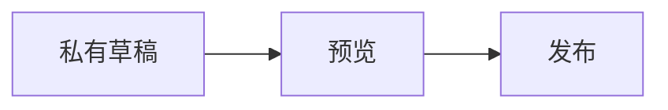

# Markdown 与作者附件

正文、目录和后台预览共用 `@hadesd/markdown`。目录从实际 Markdown AST 提取，包含 ATX / Setext 标题、引用内标题与重复标题的稳定 ID；不会把围栏代码中的 `#` 当作目录。正文先经过 HTML 清理，再以 `trust: false` 渲染数学，不执行原始 HTML、脚本或 MDX。

## 写作示例

```markdown
## 一段记录

可以使用 **强调**、~~删除线~~、[链接](https://example.com)、`行内代码`。

| 项目 | 数值 |
| --- | ---: |
| 电压 | 3.3 V |

- [x] 已完成
- [ ] 待验证

带脚注的文字[^source]。

[^source]: 脚注内容，正文与脚注之间有返回链接。

行内公式 $E = mc^2$，独立公式使用单独行的两个美元符号。

> [!NOTE]
> 这是一条说明。也支持 TIP、IMPORTANT、WARNING、CAUTION。

:::details[展开实验记录]
这里可以继续写表格、代码和数学。
:::

:::warning
请核对参数。
:::
```

代码围栏支持 JavaScript / JSX、TypeScript / TSX、Java、Python、Go、Rust、Bash / Shell、JSON、CSS、SQL、YAML、HTML / XML、C / C++、Kotlin、Markdown、Diff 和 Dockerfile。高亮来自注册的语言语法，输出 React 文本与 `span`，不插入原始高亮 HTML。未知语言和超过 50,000 字符的单个代码块保留纯文本，仍可复制。此实现采用 [lowlight 的 HAST API](https://github.com/wooorm/lowlight)。

````markdown
```python
def hello(name):
    return f"hello {name}"
```


````

Mermaid 首屏和服务端只输出源代码与“渲染 Mermaid 图表”按钮。点击后才加载 Mermaid 及需要的图型代码；错误时保留源码，可修改或重试。图表限制 20,000 字符、300 条边，使用 strict 安全级别，不接受作者提供的初始化指令或配置前言；关闭 HTML labels，渲染结果经 DOMPurify 清理后以 Blob 图像显示，不挂载交互 SVG、不执行图中链接。卸载和替换时回收 Blob URL。发布页 CSP 需要允许 `img-src blob:`。相关 API 见 [Mermaid 使用文档](https://mermaid.js.org/config/usage.html) 与 [安全级别配置](https://mermaid.js.org/config/schema-docs/config-properties-securitylevel.html)。

提示与折叠块由 [remark-directive](https://github.com/remarkjs/remark-directive) 解析，只接受上面列出的块名称，忽略作者属性；原始 `<details>` 等 HTML 仍不会执行。

## 图片和附件

后台正文工具栏“＋附件”、拖入正文编辑区、粘贴截图均可上传并插入引用，每批最多 8 个文件。上传期间可以继续输入；完成时只替换自己的占位，不恢复旧的文本快照。用户删除占位后不会重新插入。失败保留后续文字并移除对应占位，重新选取文件即可重试。上传完成前暂停自动与手动保存、发布，随后恢复自动保存，避免把临时占位写入修订。

| 类型 | 上限 | 说明 |
| --- | ---: | --- |
| PNG / JPEG / WebP | 10 MiB | 可作为正文图片或封面 |
| PDF / ZIP | 25 MiB | 以下载附件插入 |
| UTF-8 文本 | 2 MiB | txt、md、markdown、csv、json、log、yaml、yml、toml、ini、conf |

浏览器的类型与大小检查仅用于及时反馈，真实内容和 ZIP 安全检查由后端负责。不接受 HTML、SVG、GIF、AVIF、XML。文件名中的 Markdown 控制字符会转义，换行转为空格。

正文保存 `/api/v1/public/media/{id}` 图片引用，非图片附加 `?download=true`。后台预览映射为当前登录账号可访问的私有媒体接口；发布权限仍由内容引用和保留版本决定。上传成功本身不会公开文件。

图片支持说明、懒加载、错误信息、重试和“查看原图”。允许 HTTPS 外链图片，原图链接始终保留。GPU 终端对跨域图片使用原生浏览器图层并按当前屏幕裁剪，避免 Canvas 的跨域像素读取限制；阅读模式使用原生 DOM。源站拒绝外链、网络错误或不允许的 URL 协议仍会触发图片失败反馈。公开上传的同源图片可直接参与终端纹理绘制。

## 依赖与验证

2026-09-10 锁定 lowlight 3.3.0、highlight.js 11.12.0、unified 11.0.5、remark-parse 11.0.0、remark-directive 4.0.0、mdast-util-to-string 4.0.0、Mermaid 11.17.2、DOMPurify 3.4.15。Mermaid 官方说明要求 Node 22.12+；仓库 Node 24 满足构建要求，React 19 与现有 React Markdown 10 保持一致。Mermaid 11.17 使用现代浏览器特性，旧浏览器加载失败会显示源代码回退，不影响正文。

相邻测试覆盖目录与渲染 ID 一致、代码围栏、GFM / 脚注、真实多语言 token、安全提示块、SSR 惰性图表、真实 Mermaid 清理、图片失败重试、图表错误 / Blob 回收、文件名转义、上传期间输入 / 删除占位 / 部分失败，以及上传暂停保存后的恢复。当前 Markdown 13 条、后台 21 条单测通过，两个包类型检查和后台生产构建通过；最终浏览器与发布验证由集成流程执行。
